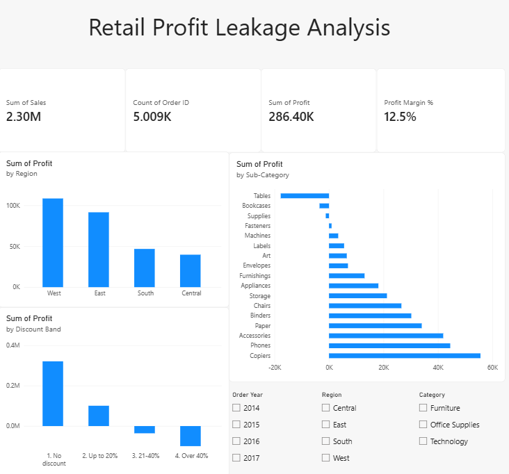

# Retail Profit Leakage Analysis

An analysis of the Superstore retail dataset to find where the business loses money and how much fixing it could recover. Built in Power BI.



## Business question
Where is this retail business losing profit, and what would fixing it recover?

## Key findings
- Overall sales were about **$2.30M** with a profit of about **$286K** (12.5% margin).
- Order lines discounted **above 20%** (1,393 lines, about 14% of all lines) lost about **$135K** in total.
- Profit falls steadily as discounts rise: positive up to 20%, then negative from 21% upward.
- **Tables** is the biggest loss-maker (about -$17.7K), and almost all of that loss comes from lines discounted above 20%.
- The **Central** region has the lowest margin (7.9%) and the heaviest discounting. The **West** has the highest margin (14.9%) and rarely discounts above 20%.
- Estimated upside of a 20% discount cap: about **+$135K to +$179K** profit, assuming sales volume holds (see `memo.md` for assumptions).

## Approach
1. Loaded the Superstore CSV (9,994 rows, 21 columns) into Power BI and checked data quality (no blanks, no duplicate rows).
2. Set data types, including parsing US-format dates.
3. Created calculated fields: Profit Margin %, Order Year, Order Month and a Discount Band grouping (none, up to 20%, 21–40%, over 40%).
4. Analysed profit by sub-category, region and discount band.
5. Built a one-page dashboard with KPI cards, three charts and slicers for year, region and category.
6. Quantified the impact of a discount cap and wrote a recommendation memo.

## Dashboard contents
- KPI cards: Total Sales, Orders, Total Profit, Profit Margin %
- Profit by Sub-Category
- Profit by Region
- Profit by Discount Band
- Slicers: Order Year, Region, Category

## Repository contents
```
retail-profit-leakage/
├── README.md
├── memo.md                         one-page recommendation for management
├── Sample - Superstore.csv         dataset
├── retail-profit-leakage.pbix      Power BI dashboard file
└── dashboard.png                   dashboard screenshot
```

## Tools
Power BI Desktop (Power Query, DAX)

## Data
Superstore sales dataset (Kaggle), 2014–2017. Not real company data.

## Author
Hansika Garg, B.Tech Information Technology, VIT Vellore
